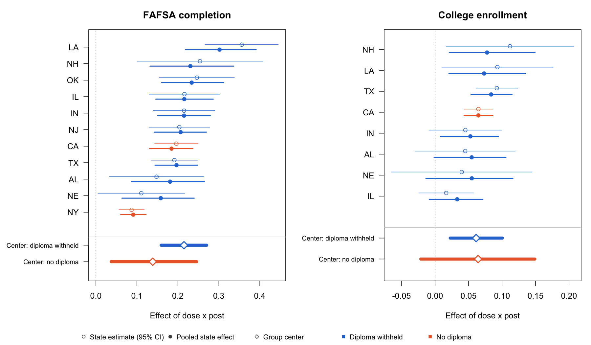

# Pooling the state estimates: summary

*Generated by `code/14_pooling_report.R` from the outputs of `code/12_aggregation.R` and `code/13_baggr_check.R`. Do not edit by hand.*

## 1. What the pooling does

Each state has its own estimate of the mandate's effect, $\hat\beta_k$: the dose $\times$ post coefficient from Deneault's specification, with a school-clustered SE $\hat s_k$. There is one for the first stage (FAFSA completion) and one for the reduced form (college enrollment). A Bayesian hierarchical model (Rubin 1981; Gelman et al. 2013, ch. 5; Meager 2019) combines them. It asks two questions: what is the average effect across states, and how much do the true effects differ once sampling noise is removed? It is baggr's "Rubin" summary-data model with partial pooling.

## 2. Model and notation

For each outcome, with states $k = 1, \dots, K$:

$$\hat\beta_k \sim N\left(\beta_k,\ \hat s_k^2\right), \qquad \beta_k \sim N\left(\mu + \delta Z_k,\ \sigma_\beta^2\right)$$

- **Data level:** each estimate is the state's true effect plus noise of known size.
- **Population level:** the true effects come from a common distribution.

| Concept | Here | baggr vignette |
|---|---|---|
| State's estimate and SE | $\hat\beta_k$, $\hat s_k$ (`beta`, `se`) | $\hat\tau_k$, $\hat{se}_k$ |
| State's true effect | $\beta_k$ (`beta_k_*`) | $\tau_k$ |
| Average effect across states (hypermean) | $\mu$ (`mu`) | $\tau$ |
| SD of true effects (hyper-SD) | $\sigma_\beta$ (`sigma_beta`) | $\sigma_\tau$ |
| Covariate coefficient | $\delta$ (`delta`) | $\beta$ |
| Covariate | $Z_k$ = `no_diploma` | covariates |

The covariate is a single indicator, $Z_k$ = `no_diploma` = 1 when the mandate does not withhold the diploma (California and New York; Pennsylvania for prediction) and 0 when it does (every other state). In the covariate model, $\mu$ is therefore the average effect in diploma-withheld states and $\delta$ is how much the effect differs in no-diploma states. Within the pooled states this split is the same as graduation requirement vs. LEA requirement. For enrollment, the no-diploma group is California alone.

## 3. Estimation window

Each state's $\hat\beta_k$ compares its post-mandate class with the average of its pre-period classes in the window. The pre-period includes the dose classes ($e = -3, -2$), which dip mechanically because the dose is built from completion in exactly those classes. So the pre-period baseline must be the same in every state, or the window itself creates differences between states. Louisiana's FSA data start at $e = -3$, so the common window is **$e = -3$ to $0$ in every state**: dose classes $-3$ and $-2$, reference class $-1$, and the first covered class $e = 0$ as the post period. Deneault's window ($e = -4$ to $+1$ where available), used for the state headline results, is pooled as a sensitivity check (section 9).

| Outcome | State | Common window (main) | Deneault window |
|---|---|---|---|
| FAFSA completion | AL | 2019-2022 (330 schools) | 2018-2023 (329 schools) |
| FAFSA completion | CA | 2020-2023 (1337 schools) | 2019-2024 (1291 schools) |
| FAFSA completion | IL | 2018-2021 (632 schools) | 2017-2022 (612 schools) |
| FAFSA completion | IN | 2021-2024 (343 schools) | 2020-2025 (339 schools) |
| FAFSA completion | LA | 2015-2018 (281 schools) | 2015-2019 (280 schools) |
| FAFSA completion | NE | 2022-2025 (197 schools) | 2021-2025 (195 schools) |
| FAFSA completion | NH | 2021-2024 (79 schools) | 2020-2024 (79 schools) |
| FAFSA completion | NJ | 2022-2025 (388 schools) | 2021-2025 (378 schools) |
| FAFSA completion | NY | 2022-2025 (1115 schools) | 2021-2025 (1097 schools) |
| FAFSA completion | OK | 2022-2025 (350 schools) | 2021-2025 (332 schools) |
| FAFSA completion | TX | 2019-2022 (1396 schools) | 2018-2023 (1318 schools) |
| College enrollment | AL | 2019-2022 (330 schools) | 2018-2023 (329 schools) |
| College enrollment | CA | 2020-2023 (1318 schools) | 2019-2023 (1280 schools) |
| College enrollment | IL | 2018-2021 (624 schools) | 2017-2022 (608 schools) |
| College enrollment | IN | 2021-2024 (343 schools) | 2020-2024 (339 schools) |
| College enrollment | LA | 2015-2018 (276 schools) | 2015-2019 (274 schools) |
| College enrollment | NE | 2022-2025 (152 schools) | 2021-2025 (147 schools) |
| College enrollment | NH | 2021-2024 (77 schools) | 2020-2024 (77 schools) |
| College enrollment | TX | 2019-2022 (1216 schools) | 2019-2023 (1161 schools) |

Balance is required only over the window's classes, so the common window keeps slightly more schools.

## 4. What pooling does to each state

Given $\mu$ and $\sigma_\beta$, each state's pooled effect is a weighted mix of the cross-state center and its own estimate (spec eq. 6):

$$\mathbb{E}\left[\beta_k \mid \hat\beta_k, \mu, \sigma_\beta\right] = \omega_k\,(\mu + \delta Z_k) + (1 - \omega_k)\,\hat\beta_k, \qquad \omega_k = \frac{\hat s_k^2}{\sigma_\beta^2 + \hat s_k^2}$$

- A precise state (small $\hat s_k$) has $\omega_k$ near 0 and keeps its own estimate.
- A noisy state has $\omega_k$ near 1 and is pulled toward the center, because its own estimate says little.
- $\sigma_\beta$ is learned from the data. If the estimates differ more than their SEs can explain, $\sigma_\beta$ is large and every state keeps more of its own estimate.

$\mu$ is a precision-weighted average of the states with weights $1 / (\hat s_k^2 + \sigma_\beta^2)$. It lies between the plain average (no pooling) and the $1/\hat s_k^2$-weighted average (full pooling, which assumes one common effect and lets the most precise states dominate). Because $\sigma_\beta$ is uncertain, the model averages over it, so every interval carries that uncertainty. Pulling noisy estimates toward the center makes the state estimates more accurate on average and keeps a noisy outlier from being over-read.

## 5. Priors

The priors are weakly informative and set on the 0-1 dose scale, with every scale halved for enrollment:

| Parameter | FAFSA completion | 95% of prior mass | College enrollment | 95% of prior mass  |
|---|---|---|---|---|
| $\mu$ | $N(0, 1)$ | [-1.96, 1.96] | $N(0, 0.5^2)$ | [-0.98, 0.98] |
| $\delta$ | $N(0, 0.5^2)$ | [-0.98, 0.98] | $N(0, 0.25^2)$ | [-0.49, 0.49] |
| $\sigma_\beta$ | $\text{Half-Normal}(0, 0.5)$ | below 0.98 (median 0.34) | $\text{Half-Normal}(0, 0.25)$ | below 0.49 (median 0.17) |

- **Not hard limits.** The 95% ranges are where the prior puts most of its weight; values outside are allowed, only considered less likely. The only hard limit is $\sigma_\beta \ge 0$ (the computation also caps $\sigma_\beta$ at 1, where the posterior has no mass).
- **Why wider than 1.** $\beta_k$ is a slope per unit of dose: the effect for a dose-1 school relative to a dose-0 school. No state spans the full 0-1 dose range (about 0.1 to 0.7-0.9), so $\beta_k$ extrapolates and can exceed 1 in principle, or be negative. A weakly informative prior is meant to be wider than the plausible range, so it gives realistic values nearly equal weight ($N(0, 1)$ at 0.4 is 92% of its peak) and only rules out impossible values.
- **Half-Normal.** A normal distribution centered at 0 and folded at zero, so only values $\ge 0$ are allowed, which suits a standard deviation. It is highest at 0 (mildly favoring similar states), declines smoothly, and has no arbitrary upper bound. Its scale is the SD of the normal before folding.
- **Why enrollment is halved.** The enrollment effect is roughly the FAFSA effect times the share of extra completers who enroll, which is well below 1. Halving keeps the two sets of priors equally weak relative to the size of each outcome's effects. A fixed factor is used rather than the observed ratio so the data are not used twice.
- **Why these and not flat priors.** They are proper, so they can be stated, checked and reproduced exactly in baggr. They are on each outcome's scale, and keep $\delta$ in a plausible range when one state carries it. The old flat/uniform priors are kept as a sensitivity check (section 9).

## 6. Main results

Posterior mean [95% interval], main priors:

| Outcome | Model | States | $\mu$ (average effect) | $\sigma_\beta$ (SD across states) | $\delta$ (no-diploma difference) |
|---|---|---|---|---|---|
| FAFSA completion | no covariate | 11 | 0.197 [0.145, 0.252] | 0.074 [0.038, 0.134] | - |
| FAFSA completion | covariate | 11 | 0.215 [0.159, 0.271] | 0.065 [0.025, 0.130] | -0.077 [-0.193, 0.042] |
| College enrollment | no covariate | 8 | 0.062 [0.031, 0.092] | 0.027 [0.002, 0.070] | - |
| College enrollment | covariate | 8 | 0.061 [0.022, 0.101] | 0.035 [0.005, 0.090] | 0.003 [-0.093, 0.097] |

- **FAFSA completion:** across states, the mandate raises completion by $\mu$ = 0.197 [0.145, 0.252] per unit of dose. True effects differ across states with $\sigma_\beta$ = 0.074 [0.038, 0.134], a large spread relative to the mean.
- **College enrollment:** the average effect is $\mu$ = 0.062 [0.031, 0.092]; the spread across states, $\sigma_\beta$ = 0.027 [0.002, 0.070], is poorly pinned down with 8 states.
- **Diploma consequence:** in no-diploma states the FAFSA effect differs by $\delta$ = -0.077 [-0.193, 0.042]; the interval includes 0. For enrollment, $\delta$ rests on California alone and is uninformative.

Predicted effects (posterior predictive: draw $\mu$, $\delta$ and $\sigma_\beta$, then a new state's effect from $N(\mu + \delta Z, \sigma_\beta^2)$) for a new state and for the states without post-mandate data yet:

| Outcome | Model | New diploma-withheld state | Connecticut | Pennsylvania |
|---|---|---|---|---|
| FAFSA completion | no covariate | 0.197 [0.032, 0.364] | 0.197 [0.032, 0.365] | 0.197 [0.032, 0.365] |
| FAFSA completion | covariate | 0.216 [0.061, 0.370] | 0.215 [0.063, 0.365] | 0.139 [-0.035, 0.319] |
| College enrollment | no covariate | 0.062 [-0.013, 0.135] | 0.062 [-0.012, 0.135] | 0.062 [-0.012, 0.134] |
| College enrollment | covariate | 0.061 [-0.034, 0.157] | 0.062 [-0.034, 0.158] | 0.065 [-0.056, 0.187] |

Predictions are wide because they include the spread across states ($\sigma_\beta$), not only uncertainty about the average.

## 7. State-level pooled effects (model without the covariate)

### FAFSA completion

| State | Own estimate $\hat\beta_k$ (SE) | Pooled effect $\beta_k$ [95%] | $\omega_k$ |
|---|---|---|---|
| LA | 0.356 (0.046) | 0.306 [0.222, 0.395] | 0.26 |
| NH | 0.254 (0.078) | 0.223 [0.118, 0.335] | 0.51 |
| OK | 0.246 (0.047) | 0.230 [0.153, 0.310] | 0.27 |
| IL | 0.216 (0.044) | 0.210 [0.137, 0.284] | 0.24 |
| IN | 0.215 (0.038) | 0.210 [0.145, 0.277] | 0.20 |
| NJ | 0.204 (0.038) | 0.202 [0.136, 0.268] | 0.19 |
| CA | 0.196 (0.027) | 0.196 [0.147, 0.246] | 0.11 |
| TX | 0.191 (0.029) | 0.192 [0.140, 0.245] | 0.12 |
| AL | 0.148 (0.059) | 0.169 [0.075, 0.256] | 0.37 |
| NE | 0.111 (0.054) | 0.144 [0.054, 0.229] | 0.33 |
| NY | 0.087 (0.016) | 0.093 [0.062, 0.124] | 0.04 |

### College enrollment

| State | Own estimate $\hat\beta_k$ (SE) | Pooled effect $\beta_k$ [95%] | $\omega_k$ |
|---|---|---|---|
| NH | 0.112 (0.049) | 0.074 [0.026, 0.137] | 0.69 |
| LA | 0.093 (0.042) | 0.070 [0.024, 0.126] | 0.63 |
| TX | 0.092 (0.016) | 0.081 [0.054, 0.112] | 0.19 |
| CA | 0.065 (0.011) | 0.064 [0.045, 0.084] | 0.10 |
| IN | 0.045 (0.028) | 0.055 [0.013, 0.092] | 0.42 |
| AL | 0.045 (0.038) | 0.057 [0.007, 0.102] | 0.58 |
| NE | 0.040 (0.054) | 0.057 [-0.002, 0.109] | 0.73 |
| IL | 0.016 (0.021) | 0.038 [-0.005, 0.073] | 0.29 |

The forest plot shows the **covariate model** (the paper's main pooling model): each state is pulled toward its own group's center, $\mu$ for diploma-withheld states (blue) and $\mu + \delta$ for no-diploma states (orange). The tables above are the model without the covariate.



## 8. Pooling metrics: how much of the cross-state variation is noise

**Average pooling factor**, evaluated at the posterior mean of $\sigma_\beta^2$ (as Meager does). Each state counts equally:

$$\bar\omega = \frac{1}{K} \sum_{k=1}^{K} \omega_k = \frac{1}{K} \sum_{k=1}^{K} \frac{\hat s_k^2}{\sigma_\beta^2 + \hat s_k^2}$$

**Generalized pooling factor** (Gelman and Pardoe 2006; Meager eq. 8), with $\varepsilon_k = \beta_k - (\mu + \delta Z_k)$ from posterior draws. Unlike $\bar\omega$, it carries the uncertainty in $\sigma_\beta$:

$$\lambda_\beta = 1 - \frac{\frac{1}{K-1} \sum_{k=1}^{K} \left(\mathbb{E}_{\text{post}}[\varepsilon_k] - \overline{\mathbb{E}_{\text{post}}[\varepsilon]}\right)^2}{\mathbb{E}_{\text{post}}\left[\frac{1}{K-1} \sum_{k=1}^{K} (\varepsilon_k - \bar\varepsilon)^2\right]}$$

Values above 0.5 mean states look different mostly by chance; values near 0 mean the differences are real. Meager's summary averages the metrics.

| Outcome | Model | $\bar\omega$ | $\lambda_\beta$ | Average | Reading |
|---|---|---|---|---|---|
| FAFSA completion | no covariate | 0.240 | 0.332 | 0.286 | mostly real differences |
| FAFSA completion | covariate | 0.274 | 0.501 | 0.388 | mostly real differences |
| College enrollment | no covariate | 0.456 | 0.705 | 0.581 | mostly sampling noise |
| College enrollment | covariate | 0.361 | 0.735 | 0.548 | mostly sampling noise |

FAFSA completion: mostly real differences ($\bar\omega$ = 0.240, $\lambda_\beta$ = 0.332). College enrollment: the metrics disagree ($\bar\omega$ = 0.456, $\lambda_\beta$ = 0.705), because $\sigma_\beta$ is poorly pinned down with few states; their average, 0.581, points to mostly sampling noise.
In the covariate model, the diploma indicator explains part of the cross-state spread, so the remaining differences look relatively more like noise ($\lambda_\beta$ rises for both outcomes).

An earlier version reported a single ratio of averages, $\overline{\hat s^2} / (\overline{\hat s^2} + \mathbb{E}[\sigma_\beta^2])$ (baggr's overall pooling). Because the noisiest states dominate the average of squared SEs, that ratio is always at least $\bar\omega$; the difference is largest for enrollment, where SEs vary most.

## 9. Sensitivity (model without the covariate)

**Window.** Pooled estimates under the common window (main) and Deneault's window, where some states include $e = -4$ and $e = +1$ and others do not:

| Outcome | Window | $\mu$ | $\sigma_\beta$ |
|---|---|---|---|
| FAFSA completion | Common, e = -3 to 0 (main) | 0.197 [0.145, 0.252] | 0.074 [0.038, 0.134] |
| FAFSA completion | Deneault, e = -4 to +1 where available | 0.166 [0.105, 0.228] | 0.089 [0.047, 0.159] |
| College enrollment | Common, e = -3 to 0 (main) | 0.062 [0.031, 0.092] | 0.027 [0.002, 0.070] |
| College enrollment | Deneault, e = -4 to +1 where available | 0.044 [0.013, 0.076] | 0.029 [0.003, 0.073] |

With windows that differ across states, part of the spread between states comes from the windows themselves, so $\sigma_\beta$ is larger; the common window removes that. The common window's baseline consists mostly of the dose classes, whose mechanical dip raises every state's $\hat\beta_k$, so $\mu$ is higher. This dip is the open pre-trend problem: it now affects every state in the same way, but the level of $\mu$ should be read with that caveat.

**Priors.**

| Outcome | Prior | $\mu$ | $\sigma_\beta$ | New state |
|---|---|---|---|---|
| FAFSA completion | Main (weakly informative) | 0.197 [0.145, 0.252] | 0.074 [0.038, 0.134] | 0.197 [0.032, 0.364] |
| FAFSA completion | Flat $\mu$, $\sigma_\beta \sim \mathrm{Uniform}(0, 1)$ | 0.198 [0.146, 0.253] | 0.074 [0.038, 0.134] | 0.198 [0.033, 0.366] |
| FAFSA completion | $\sigma_\beta \sim \text{Half-Cauchy}(0, 0.05)$ | 0.197 [0.150, 0.246] | 0.065 [0.034, 0.113] | 0.197 [0.053, 0.346] |
| College enrollment | Main (weakly informative) | 0.062 [0.031, 0.092] | 0.027 [0.002, 0.070] | 0.062 [-0.013, 0.135] |
| College enrollment | Flat $\mu$, $\sigma_\beta \sim \mathrm{Uniform}(0, 1)$ | 0.062 [0.032, 0.092] | 0.027 [0.002, 0.070] | 0.062 [-0.013, 0.135] |
| College enrollment | $\sigma_\beta \sim \text{Half-Cauchy}(0, 0.05)$ | 0.062 [0.034, 0.088] | 0.023 [0.002, 0.057] | 0.062 [-0.001, 0.125] |

The average effect does not depend on the prior. Only the skeptical half-Cauchy prior, which favors similar states, moves $\sigma_\beta$ (down by about 10-15%) and narrows the predictions. Each posterior interval is a small fraction of its prior range: the data, not the priors, drive the results.

## 10. Leave-one-state-out

2 of 19 state estimates fall outside the 95% predictive interval built from the other states:

- LA, FAFSA completion: $\hat\beta_k$ = 0.356; the other states predict 0.181 [0.052, 0.314].
- NY, FAFSA completion: $\hat\beta_k$ = 0.087; the other states predict 0.212 [0.094, 0.331].

These states are unusual relative to the rest, so check their designs and data before reading their shrunk effects.

## 11. Cross-check with baggr

baggr 0.8.2 (Wiecek and Meager; Stan MCMC, 4 chains x 40,000 iterations) fits the same model with the same main priors. 22 of 22 parameters match (means within 0.1 and 95% bounds within 0.2 posterior SDs of the exact result); largest R-hat 1.000. baggr was archived on CRAN on 2026-11-01, so the main code does not depend on it.

## 12. Computation

`code/12_aggregation.R` computes the posterior exactly in base R: $\sigma_\beta$ is drawn from its marginal posterior on a 5,000-point grid, then $\mu$, $\delta$ and $\beta_k$ from their normal conditionals (Gelman et al. 2013, ch. 5). This works because the model has a single variance parameter. A model with several (for example, pooling FAFSA completion and enrollment jointly) would need MCMC through baggr or Stan.

## 13. Caveats

- The state estimates inherit the open pre-trend problem in the event studies (DECISIONS 2026-11-11). The dose classes make up two-thirds of the common window's baseline, so the mechanical dip likely raises every state's estimate and the pooled mean; the common window makes this bias the same across states, not zero.
- The enrollment outcome is defined differently across states (timing window, in-state only, data source), so $\sigma_\beta$ for enrollment mixes real heterogeneity with definition differences.
- State SEs are treated as known, which is standard for summary-data pooling.
- Maryland is excluded (no FAFSA requirement). Connecticut and Pennsylvania have no post-mandate data yet; their predictions are an out-of-sample test to check later.
- The connection to Meager (2019) is described, not quoted; the model is matched to her equations as summarized in the project spec.

## Reproduce

```bash
Rscript code/12_aggregation.R    # exact pooling (base R)
Rscript code/13_baggr_check.R    # optional cross-check (needs baggr 0.8.2; see README)
Rscript code/14_pooling_report.R # this summary
```
